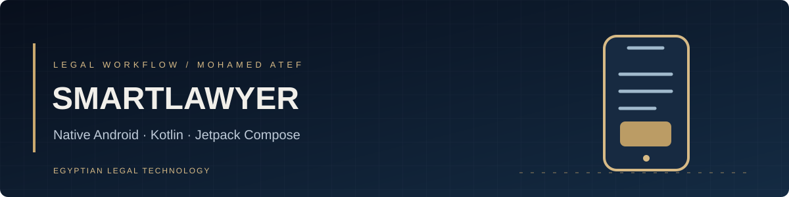
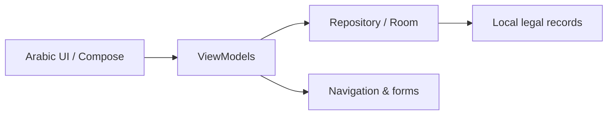

<div align="center">


# SmartLawyer
**إدارة العمل القانوني على Android**

[Developer profile](https://github.com/matef-hub) · [Judicial Agenda](https://github.com/matef-hub/agenda)
</div>

## About

**SmartLawyer** is a Kotlin and Jetpack Compose project for Egyptian legal workflows on Android. Its modules cover clients, case information, court sessions and practice-oriented navigation with Arabic UI support.

The project uses Android architecture components including **Room**, **Hilt** and Compose. This is a development repository: features and end-to-end behavior must be tested on a real device or emulator before being described as ready for client use.



## Build

Open in Android Studio with a suitable Android SDK and Java 17. From Windows:

```powershell
.\gradlew.bat :app:assembleDebug
```

### Planned / verification-required

- Google Drive backup and restore must be checked end-to-end before being advertised as reliable.
- Authentication, validation, saved-record persistence and navigation need device testing.
- A `mynewkey.keystore` file was previously tracked and has been removed from the latest tree, but may remain in historical commits. **Treat this as potential signing-key exposure**. Determine whether it signed releases and follow the appropriate Android/Play key recovery process.

## Responsible use

Do not put real client documents, IDs or credentials in issues, screenshots, source control or sample data. This application does not substitute for reviewing official legal material.

**Mohamed Atef** · Lawyer & Legal Tech Developer
